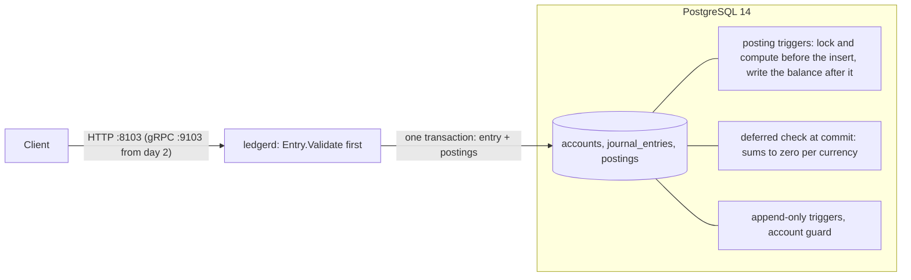

# Ledger

[](https://github.com/vivekdavara/ledger/actions/workflows/ci.yml)

A double-entry payments ledger in Go and PostgreSQL. Every movement of money is a journal entry whose postings sum
to zero in each currency, so money is moved, never created or destroyed. The rule is checked twice: by the Go
validator, for clear errors, and by the database at commit, so no bug, second writer or hand-typed `psql` session
can break it.

> **Status: day 1 of 5.** The money type, the entry validator, the schema with its database-enforced invariants,
> the migration runner, the `ledgerd` binary with health endpoints, and CI. Two review agents then found five
> real problems, all fixed with a test each (under "Review of the day's work"). The API (gRPC and REST) comes on
> day 2.
> [DESIGN.md](DESIGN.md) is the full design and the plan for the remaining days.

## Architecture



Amounts are `int64` minor units (cents, yen, fils); positive is a debit, negative a credit. An account's stored
balance is the sum of its postings, and the database maintains it, so it can't drift.

## The rules, and what enforces them

| Rule | Go | Database |
|---|---|---|
| An entry's postings sum to zero in each currency | `Entry.Validate` | deferred constraint trigger, at commit |
| 2 to 64 postings, exactly as many as declared | `Entry.Validate` | `CHECK` + the commit-time trigger |
| A posting's currency is its account's | (needs the account) | composite foreign key `(account_id, currency)` |
| A balance is the sum of its postings, with a gapless version chain | (the database does it) | `BEFORE` and `AFTER INSERT` triggers on postings |
| A protected account never goes below zero | (day 2) | `CHECK` evaluated inside the row-locked update |
| History is append-only | no code path changes it | triggers reject `UPDATE`, `DELETE`, `TRUNCATE` |
| A balance changes only through postings | no code path changes it | guard trigger on accounts |

## Run it

You need Go 1.27 and PostgreSQL 14 on port 5432.

```bash
./scripts/dev-db.sh
```

That creates `ledger` (for running the service) and `ledger_test` (for the tests). Then:

```bash
make check
```

`make check` is what CI runs: `gofmt`, `go vet`, and every test with the race detector. The database tests use
`LEDGER_TEST_DATABASE_URL`, which the Makefile points at `ledger_test`. Without it they skip, except in CI, where
they fail.

```bash
LEDGER_DATABASE_URL="postgres://localhost:5432/ledger?sslmode=disable" go run ./cmd/ledgerd serve
```

`serve` applies any pending migrations (so does `ledgerd migrate`, which then exits) and listens on
`LEDGER_HTTP_ADDR`, default `:8103`:

```bash
curl -s localhost:8103/livez
```

```bash
curl -s localhost:8103/readyz
```

`/livez` checks nothing and answers while the process runs. `/readyz` answers 200 only when the database responds
within 2 s and its schema is at the binary's newest migration, and 503 with the reason otherwise.

## Tests

66 test functions (several table-driven or property-based), all green locally and in CI:

- `internal/money`: exact parsing and formatting (`"12.345"` in USD is an error, not a rounding), a round-trip
  property over every `int64`, overflow-checked addition against `math/big`, and a fuzz target.
- `internal/ledger`: every validation rule, plus properties over random balanced entries: they validate, moving
  any amount or currency unbalances them, a reversal cancels out, and whether an entry is valid never depends on
  its postings' order, with up to three defects mixed in.
- `internal/store`: each test gets a fresh schema in `ledger_test`. The migration runner (eight concurrent
  runners apply each migration once, at every isolation level); every constraint and trigger by name; ten
  concurrent $5 payments against $30 (always six succeed); every write path (single and multi-row `INSERT`,
  `COPY`, a writable CTE, `ON CONFLICT`, savepoints, `SET CONSTRAINTS`); and a differential property test where the
  Go validator and the database must agree, for the same reason, on random entries carrying none or one of nine
  defects.
- `internal/server`, `cmd/ledgerd`: the health endpoints, and a real server started, called and shut down.

## Results

What the database's rules cost, from `BenchmarkPostEntry` (`internal/store/bench_test.go`). One client posts one
balanced entry per transaction: begin, insert the entry, insert its postings in one statement, commit. So each
number is the latency of one entry, mostly the commit's write to disk. "Check off" disables the commit-time check's
two constraint triggers; the balance triggers stay on.

Apple M3, Postgres 14.20 (Homebrew, default settings), over local TCP. Median of 6 runs per cell, from two rounds
of `-count 3`, run before/after/after/before so that drift hits both builds alike:

| Postings per entry | Check | Before the review fixes (0001–0003) | Now (0001–0007) |
|---|---|---|---|
| 2 | on | 275 µs | 302 µs |
| 2 | off | 232 µs | 248 µs |
| 8 | on | 700 µs | 859 µs |
| 8 | off | 580 µs | 712 µs |
| 64 | on | 3,753 µs | 4,426 µs |
| 64 | off | 2,241 µs | 2,681 µs |

```bash
make bench
```

That runs the current build. For the "before" column, check out `c09ef08` (in a worktree, say) and run `make bench`
there.

What the numbers say:

- **The commit-time check costs about a fifth of a small entry**: 54 µs of 302 µs at 2 postings. At 64 postings
  it is 1.7 ms, 65%, because each posting checks the whole entry again: N + 1 checks of N rows each. The attempt
  to check once per entry (0004) was unsound and was undone (see "Review of the day's work").
- **The review fixes cost 10% at 2 postings and 18–23% at 8 and 64.** Each posting now runs two balance triggers
  instead of one (lock and compute before the insert, write after it), and every trigger function runs with a
  pinned `search_path`. The two causes weren't measured separately.
- These are single-client latencies, not throughput. Day 4 measures throughput and contention.
- An earlier run, made while the review agents were using the same Postgres, was up to three times slower on the
  large cases in one round; it isn't reported.

## Review of the day's work

After the core was built, two review agents read it, one for the SQL and one for the Go, and reproduced what they
suspected. I re-ran every finding myself before fixing it. Five were real; each fix has a test that fails without
it:

1. **A balance could move with no posting** (both agents). The balance moved in a `BEFORE INSERT` trigger, and
   `INSERT ... ON CONFLICT DO NOTHING` on a conflicting posting then skipped the row but kept the balance change:
   `INSERT 0 0`, no error, and the books stopped summing to zero. Fixed in migration 0006 (the balance is written
   by an `AFTER` trigger); `TestASkippedPostingMovesNoBalance`.
2. **An optimisation let an unbalanced entry commit.** Migration 0004 skipped a posting's commit-time check when
   its entry was the transaction's own. `SET CONSTRAINTS ALL IMMEDIATE` used up the entry's check early, and a
   posting appended afterwards was never checked. Undone in 0005; `TestAnEarlyCheckDoesNotExcuseLaterPostings`.
3. **A temporary table could stand in for `accounts`.** The trigger functions resolved table names through the
   caller's `search_path`, where `pg_temp` comes first. Pinned in 0007;
   `TestATempTableCannotStandInForTheLedgersTables`, `TestEveryFunctionPinsItsSearchPath`.
4. **The migration lock failed under a serializable default.** Its snapshot predated the lock wait, and 7 of 8
   concurrent runners re-applied migrations. Migrations now run at `READ COMMITTED`; the race test runs at all
   three isolation levels.
5. **Tests that hang instead of failing.** A missing rollback or timeout would have hung the run, and CI's
   implicit 10-minute test timeout equalled the job's. Tests now check for leaked connections, the readiness test
   has its own deadline, and `go test` runs with `-timeout 4m`. (A property test that couldn't fail on what its
   name claimed was also rewritten.)

## Layout

```
cmd/ledgerd/              the binary: migrate and serve
internal/money/           currencies, amounts, exact parsing
internal/ledger/          Entry, Posting, Validate
internal/store/           Open, the migration runner, Ready
internal/store/migrations 0001 to 0007 (DESIGN.md, "Schema", says what each does)
internal/store/storetest/ a fresh schema per test
internal/server/          HTTP handlers
```

## License

MIT
