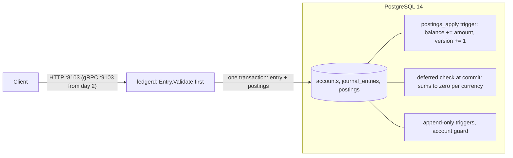

# Ledger

[](https://github.com/vivekdavara/ledger/actions/workflows/ci.yml)

A double-entry payments ledger in Go and PostgreSQL. Every movement of money is a journal entry whose postings sum
to zero in each currency, so money is moved, never created or destroyed. The rule is checked twice: by the Go
validator, for clear errors, and by the database at commit, so no bug, second writer or hand-typed `psql` session
can break it.

> **Status: day 1 of 5.** The money type, the entry validator, the schema with its database-enforced invariants,
> the migration runner, the `ledgerd` binary with health endpoints, and CI. The API (gRPC and REST) comes on day 2.
> [DESIGN.md](DESIGN.md) is the full design and the plan for the remaining days.

## Architecture



Amounts are `int64` minor units (cents, yen, fils); positive is a debit, negative a credit. An account's stored
balance is the sum of its postings, and the database maintains it, so it can't drift.

## The rules, and what enforces them

| Rule | Go | Database |
|---|---|---|
| An entry's postings sum to zero in each currency | `Entry.Validate` | deferred constraint trigger, at commit |
| 2 to 64 postings, exactly as many as declared | `Entry.Validate` | `CHECK` + the commit-time trigger |
| A posting's currency is its account's | (needs the account) | composite foreign key `(account_id, currency)` |
| A balance is the sum of its postings, with a gapless version chain | (the database does it) | `BEFORE INSERT` trigger on postings |
| A protected account never goes below zero | (day 2) | `CHECK` evaluated inside the row-locked update |
| History is append-only | no code path changes it | triggers reject `UPDATE`, `DELETE`, `TRUNCATE` |
| A balance changes only through postings | no code path changes it | guard trigger on accounts |

## Run it

You need Go 1.27 and PostgreSQL 14 on port 5432.

```bash
./scripts/dev-db.sh
```

That creates `ledger` (for running the service) and `ledger_test` (for the tests). Then:

```bash
make check
```

`make check` is what CI runs: `gofmt`, `go vet`, and every test with the race detector. The database tests use
`LEDGER_TEST_DATABASE_URL`, which the Makefile points at `ledger_test`. Without it they skip, except in CI, where
they fail.

```bash
LEDGER_DATABASE_URL="postgres://localhost:5432/ledger?sslmode=disable" go run ./cmd/ledgerd serve
```

`serve` applies any pending migrations (so does `ledgerd migrate`, which then exits) and listens on
`LEDGER_HTTP_ADDR`, default `:8103`:

```bash
curl -s localhost:8103/livez
```

```bash
curl -s localhost:8103/readyz
```

`/livez` checks nothing and answers while the process runs. `/readyz` answers 200 only when the database responds
within 2 s and its schema is at the binary's newest migration, and 503 with the reason otherwise.

## Tests

56 test functions (several table-driven or property-based), all green locally and in CI:

- `internal/money`: exact parsing and formatting (`"12.345"` in USD is an error, not a rounding), a round-trip
  property over every `int64`, overflow-checked addition against `math/big`, and a fuzz target.
- `internal/ledger`: every validation rule, plus properties over random balanced entries: they validate, moving
  any amount or currency unbalances them, a reversal cancels out, and whether an entry is valid never depends on
  its postings' order, with up to three defects mixed in.
- `internal/store`: each test gets a fresh schema in `ledger_test`. The migration runner (eight concurrent
  runners apply each migration once); every constraint and trigger by name; ten concurrent $5 payments against
  $30 (always six succeed); and a differential property test where the Go validator and the database must agree,
  for the same reason, on random entries carrying none or one of nine defects.
- `internal/server`, `cmd/ledgerd`: the health endpoints, and a real server started, called and shut down.

## Layout

```
cmd/ledgerd/              the binary: migrate and serve
internal/money/           currencies, amounts, exact parsing
internal/ledger/          Entry, Posting, Validate
internal/store/           Open, the migration runner, Ready
internal/store/migrations 0001_schema, 0002_balances, 0003_entries, 0004_check_entries_once
internal/store/storetest/ a fresh schema per test
internal/server/          HTTP handlers
```

## License

MIT
