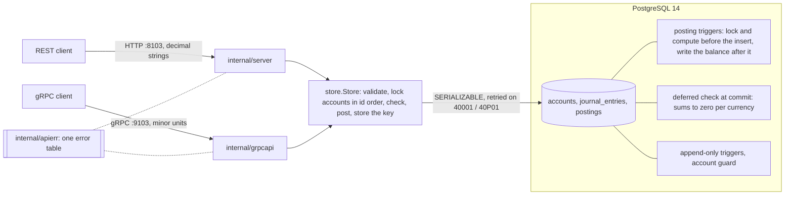

# Ledger

[](https://github.com/vivekdavara/ledger/actions/workflows/ci.yml)

A double-entry payments ledger in Go and PostgreSQL. Every movement of money is a journal entry whose postings sum
to zero in each currency, so money is moved, never created or destroyed. The rule is checked twice: by the Go
validator, for clear errors, and by the database at commit, so no bug, second writer or hand-typed `psql` session
can break it.

> **Status: day 2 of 5.** Day 1: the money type, the entry validator, the schema with its database-enforced
> invariants, the migration runner, health endpoints and CI. Day 2: the API, REST on :8103 and gRPC on :9103 over
> one service: accounts, balances, paged history, and posting entries atomically under `SERIALIZABLE` with
> retries and idempotency keys. Next: concurrency strategies compared, an outbox and reconciliation (day 3).
> [DESIGN.md](DESIGN.md) is the full design and the plan for the remaining days.

## Architecture



Amounts are `int64` minor units (cents, yen, fils); positive is a debit, negative a credit. An account's stored
balance is the sum of its postings, and the database maintains it, so it can't drift.

## The rules, and what enforces them

| Rule | Go | Database |
|---|---|---|
| An entry's postings sum to zero in each currency | `Entry.Validate` | deferred constraint trigger, at commit |
| 2 to 64 postings, exactly as many as declared | `Entry.Validate` | `CHECK` + the commit-time trigger |
| A posting's currency is its account's | (needs the account) | composite foreign key `(account_id, currency)` |
| A balance is the sum of its postings, with a gapless version chain | (the database does it) | `BEFORE` and `AFTER INSERT` triggers on postings |
| A protected account never goes below zero | (day 2) | `CHECK` evaluated inside the row-locked update |
| History is append-only | no code path changes it | triggers reject `UPDATE`, `DELETE`, `TRUNCATE` |
| A balance changes only through postings | no code path changes it | guard trigger on accounts |

## Run it

You need Go 1.27 and PostgreSQL 14 on port 5432.

```bash
./scripts/dev-db.sh
```

That creates `ledger` (for running the service) and `ledger_test` (for the tests). Then:

```bash
make check
```

`make check` is what CI runs: `gofmt`, `go vet`, and every test with the race detector. The database tests use
`LEDGER_TEST_DATABASE_URL`, which the Makefile points at `ledger_test`. Without it they skip, except in CI, where
they fail.

```bash
LEDGER_DATABASE_URL="postgres://localhost:5432/ledger?sslmode=disable" go run ./cmd/ledgerd serve
```

`serve` applies any pending migrations (so does `ledgerd migrate`, which then exits) and listens on
`LEDGER_HTTP_ADDR` (REST and health, default `:8103`) and `LEDGER_GRPC_ADDR` (default `:9103`). On SIGTERM both
stop accepting, give in-flight requests 10 s, then cut what's left.

```bash
curl -s localhost:8103/livez
```

```bash
curl -s localhost:8103/readyz
```

`/livez` checks nothing and answers while the process runs. `/readyz` answers 200 only when the database responds
within 2 s and its schema is at the binary's newest migration, and 503 with the reason otherwise.

## The API

Start the server as above, then (the `id`s are what a fresh `ledger` database gives):

```bash
curl -s -X POST localhost:8103/v1/accounts -H 'Content-Type: application/json' -d '{"name":"cash:bank","type":"asset","currency":"USD"}'
```

```bash
curl -s -X POST localhost:8103/v1/accounts -H 'Content-Type: application/json' -d '{"name":"wallet:alice","type":"liability","currency":"USD"}'
```

Bodies are JSON, sent as `application/json`. Post an entry; the `Idempotency-Key` header is required, and a retry
sends the same one:

```bash
curl -s -X POST localhost:8103/v1/entries -H 'Content-Type: application/json' -H 'Idempotency-Key: top-up-1' -d '{"description":"Alice tops up $50","postings":[{"account_id":1,"currency":"USD","amount":"50.00"},{"account_id":2,"currency":"USD","amount":"-50.00"}]}'
```

The answer is 201 with the entry as posted, each posting with the balance after it and its place in the account's
history. The same request again answers 200 with `Idempotent-Replayed: true` and the same entry, and moves no money.
The same key with a different entry is refused with `idempotency_key_reused`.

```bash
curl -s localhost:8103/v1/accounts/2
```

```bash
curl -s 'localhost:8103/v1/accounts/2/postings?limit=100'
```

Amounts are decimal strings in the currency's major unit (`"20.00"`, `"1500"` for JPY), never floats. A wallet is a
liability, so its stored `balance` is negative (a credit) and its `shown_balance` positive. Errors name a stable
reason and, when one posting is at fault, its index. From the hand check (an account holding $30.00):

```json
{"error":{"reason":"insufficient_funds","message":"posting 0: insufficient funds: account 2 (wallet:alice) has 30.00 USD, the posting takes 30.01","posting":0}}
```

The gRPC service is `ledger.v1.LedgerService` ([proto/ledger/v1/ledger.proto](proto/ledger/v1/ledger.proto)),
with amounts in minor units. Server reflection is on, and grpcurl is pinned in the tools module:

```bash
go tool -modfile=tools/go.mod grpcurl -plaintext -d '{"id": 2}' localhost:9103 ledger.v1.LedgerService/GetAccount
```

A failed call carries the same reason in a `google.rpc.ErrorInfo` (`INSUFFICIENT_FUNDS`, metadata `posting: 0`).
The full error table, and why each status, is in DESIGN.md, "Errors". Keys are shared by the two APIs: in the hand
check, an entry posted over REST came back as `"replayed": true` when the same key and postings, in another order,
were sent over gRPC.

`make proto` lints the proto file and regenerates `internal/gen`; the generated code is committed.

## Tests

97 test functions (several table-driven or property-based), all green locally and in CI:

- `internal/money`: exact parsing and formatting (`"12.345"` in USD is an error, not a rounding), a round-trip
  property over every `int64`, overflow-checked addition against `math/big`, and a fuzz target.
- `internal/ledger`: every validation rule, plus properties over random balanced entries: they validate, moving
  any amount or currency unbalances them, a reversal cancels out, and whether an entry is valid never depends on
  its postings' order, with up to three defects mixed in.
- `internal/store`: each test gets a fresh schema in `ledger_test`. The migration runner (eight concurrent
  runners apply each migration once, at every isolation level); every constraint and trigger by name; ten
  concurrent $5 payments against $30 (always six succeed); every write path (single and multi-row `INSERT`,
  `COPY`, a writable CTE, `ON CONFLICT`, savepoints, `SET CONSTRAINTS`); and a differential property test where the
  Go validator and the database must agree, for the same reason, on random entries carrying none or one of nine
  defects.
- `internal/store`, the service (day 2): idempotent account creation (eight concurrent creates make one account);
  history pages; every rejection names its posting and leaves nothing behind, its key included; a retried request
  posts once, even with its postings reordered; twelve requests with one key, held at a barrier until all have read
  the key as unused, post one entry and replay eleven times; a serialization failure forced with a test hook
  (another payment commits between the attempt's snapshot and its lock) is retried and posts against the new
  balance; retries that run out give `ErrConflict` and store no key; a retry's wait ends with its context; eight
  workers making 80 colliding transfers keep the books balanced. A property test sends random requests at once,
  each several times and some with a different entry under the same key: each key posts exactly once, every
  send of that entry gets it back field for field, and the others are refused (100 cases; it fails against a
  build that skips the hash comparison, and one that doesn't store the key).
- `internal/apierr`: every error's reason, HTTP status and gRPC code, and which ones are redacted.
- `internal/server`: the REST API over a real schema, including 14 malformed or refused requests, each checked for
  its status, reason, posting and message, and the health endpoints. A request stuck behind a row lock gives up at
  its deadline with 504, uses up no key, and posts once the lock is gone.
- `internal/grpcapi`: the gRPC API over an in-memory connection (bufconn) on a real schema: the same walkthrough,
  each error's code, `ErrorInfo` reason and posting, and the call deadline. `TestBothAPIsGiveTheSameReason` sends
  22 failing requests through both APIs and requires the same reason and posting from each.
- `cmd/ledgerd`: the real binary's `run`: migrations, an account created over REST and read back over gRPC from
  real ports, a clean shutdown of both, and a taken port failing startup.

## Results

### Day 1: what the database's rules cost

From `BenchmarkPostEntry` (`internal/store/bench_test.go`). One client posts one
balanced entry per transaction: begin, insert the entry, insert its postings in one statement, commit. So each
number is the latency of one entry, mostly the commit's write to disk. "Check off" disables the commit-time check's
two constraint triggers; the balance triggers stay on.

Apple M3, Postgres 14.20 (Homebrew, default settings), over local TCP. Median of 6 runs per cell, from two rounds
of `-count 3`, run before/after/after/before so that drift hits both builds alike:

| Postings per entry | Check | Before the review fixes (0001–0003) | Now (0001–0007) |
|---|---|---|---|
| 2 | on | 275 µs | 302 µs |
| 2 | off | 232 µs | 248 µs |
| 8 | on | 700 µs | 859 µs |
| 8 | off | 580 µs | 712 µs |
| 64 | on | 3,753 µs | 4,426 µs |
| 64 | off | 2,241 µs | 2,681 µs |

```bash
make bench
```

That runs the current build. For the "before" column, check out `c09ef08` (in a worktree, say) and run `make bench`
there.

What the numbers say:

- **The commit-time check costs about a fifth of a small entry**: 54 µs of 302 µs at 2 postings. At 64 postings
  it is 1.7 ms, 65%, because each posting checks the whole entry again: N + 1 checks of N rows each. The attempt
  to check once per entry (0004) was unsound and was undone (see "Review of day 1").
- **The review fixes cost 10% at 2 postings and 18–23% at 8 and 64.** Each posting now runs two balance triggers
  instead of one (lock and compute before the insert, write after it), and every trigger function runs with a
  pinned `search_path`. The two causes weren't measured separately.
- These are single-client latencies, not throughput. Day 4 measures throughput and contention.
- An earlier run, made while the review agents were using the same Postgres, was up to three times slower on the
  large cases in one round; it isn't reported.

### Day 2: what the service adds

`BenchmarkServicePostEntry` posts the same entries through `Store.PostEntry`, the API's path: validate and hash in
Go, look the key up, then one `SERIALIZABLE` transaction that locks the accounts, inserts the entry, its postings
and the key, and commits. "Replay" sends one key again and again: the cost of answering a retry. One client, Apple
M3, Postgres 14.20 at default settings, at `5fb9557` (migrations 0001–0008). Median of 6 runs, two rounds of
`-count 3` (`make bench`), with nothing else running:

| Postings per entry | Plain insert (check on) | Through the service | Replay |
|---|---|---|---|
| 2 | 300 µs | 434 µs | 80 µs |
| 8 | 849 µs | 1,124 µs | 85 µs |
| 64 | 4,256 µs | 5,001 µs | 116 µs |

- **The service adds 134 µs at 2 postings (45%), 274 µs at 8 and 745 µs at 64.** It sends three more statements
  (the key lookup, the locking `SELECT`, the key insert) and runs at `SERIALIZABLE`, whose predicate locks cost
  more as the entry grows. Their shares weren't measured separately.
- **A replay costs about a fifth of a post** at 2 postings and a fortieth at 64: three reads and no commit to disk.
- The plain-insert column is day 1's "Now" column re-measured with migration 0008: 300, 849 and 4,256 µs against
  302, 859 and 4,426. 0008's CHECK on balances costs nothing these runs can see.

Transfers that share nothing, before and after moving the key lookup out of the transaction (DESIGN.md, "Why the
key lookup is outside the transaction"). 16 workers, each moving $0.10 back and forth between its own two wallets 25
times, all at once, with the default retry policy; three runs each:

| Build | Retries | Requests that ran out of attempts |
|---|---|---|
| Before (`bc5e6f6`) | 285, 215, 324 | 2, 1, 1 |
| After (`2155237`) | 68, 78, 142 | 0, 0, 0 |

```bash
LEDGER_TEST_DATABASE_URL="postgres://localhost:5432/ledger_test?sslmode=disable" go test -count=1 -v -run TestDisjointTransfersRetries ./internal/store
```

For the "before" row, run that test (copied in) at `bc5e6f6`. The retries that remain are day 3's subject.

## Review of day 2

After the API was built, two review agents read it, one for the store's posting logic and one for the REST and gRPC
layers, each in its own git worktree and test schemas. They reported only what they had reproduced; I reproduced
each finding again before fixing it, and each fix has a test that fails without it. Three of the API agent's
findings were already fixed by then (account id 0 disagreeing between the APIs, no request deadline, a stale
README line); I had found the first while writing the cross-API test.

1. **Unrelated transfers made each other retry.** The idempotency-key lookup ran inside the `SERIALIZABLE`
   transaction, where a read that finds nothing takes a predicate lock on where the key would be (the index page,
   or the whole small table); every concurrent request writing a key there then counted as a conflict. 16 workers on their own wallets: 215–324 retries and 1–2 requests out
   of attempts, three runs. The lookup now runs before the transaction: 68–142 retries, none out of attempts
   (`TestDisjointTransfersRetries`, `TestUnrelatedEntriesDontMakeEachOtherRetry`).
2. **The retry delay panicked** for a `MaxDelay` near `MaxInt64` (`rand.N(MaxInt64 + 1)`), overflowed its shift for
   a large `BaseDelay`, and misread zero values (`TestRetryDelayStaysWithinItsBounds`).
3. **REST requests weren't cut off at the end of the shutdown grace,** and the pool's `Close` waited for them; a
   stop as the server started could exit 1 (`TestShutdownCutsOffWorkStillRunningAfterTheGrace`,
   `TestAStopAsServeStartsIsClean`).
4. **Postgres's text reached clients**, in the conflict message and in the database fallback's detail, and a
   backend killed mid-request was a 500 instead of a 503. Redaction itself had no test that could fail
   (`TestUnplannedAndUnavailableErrorsAreRedacted`, `TestTranslateNamesTheConstraintNotPostgresText`).
5. **REST accepted what the ledger refuses:** invalid UTF-8 (two names became one account), repeated keys (the last
   won), field names in any case; also no content-type check, 400 for an oversized body, text/plain 404s and 405s,
   and messages naming Go types (`TestRESTRefusesWhatEncodingJSONWouldAccept`, `TestRouterErrorsAreJSON`).
6. **The APIs disagreed on negative paging values** (`TestBothAPIsGiveTheSameReason` has them now).

They also listed tests that still passed with their mechanism removed: the key check, the `23505` and `40P01`
retries, id-order locking, history page sizes, the -2^63 rule, the body cap, the default page's cursor, gRPC's
message cap, and a listener left open on a failed start. Each now has a test that fails without it, checked by
removing the mechanism. Judgement calls that stayed as they are, with the reason, are in DESIGN.md's
"Limitations".

## Review of day 1

After the core was built, two review agents read it, one for the SQL and one for the Go, and reproduced what they
suspected. I re-ran every finding myself before fixing it. Five were real; each fix has a test that fails without
it:

1. **A balance could move with no posting** (both agents). The balance moved in a `BEFORE INSERT` trigger, and
   `INSERT ... ON CONFLICT DO NOTHING` on a conflicting posting then skipped the row but kept the balance change:
   `INSERT 0 0`, no error, and the books stopped summing to zero. Fixed in migration 0006 (the balance is written
   by an `AFTER` trigger); `TestASkippedPostingMovesNoBalance`.
2. **An optimisation let an unbalanced entry commit.** Migration 0004 skipped a posting's commit-time check when
   its entry was the transaction's own. `SET CONSTRAINTS ALL IMMEDIATE` used up the entry's check early, and a
   posting appended afterwards was never checked. Undone in 0005; `TestAnEarlyCheckDoesNotExcuseLaterPostings`.
3. **A temporary table could stand in for `accounts`.** The trigger functions resolved table names through the
   caller's `search_path`, where `pg_temp` comes first. Pinned in 0007;
   `TestATempTableCannotStandInForTheLedgersTables`, `TestEveryFunctionPinsItsSearchPath`.
4. **The migration lock failed under a serializable default.** Its snapshot predated the lock wait, and 7 of 8
   concurrent runners re-applied migrations. Migrations now run at `READ COMMITTED`; the race test runs at all
   three isolation levels.
5. **Tests that hang instead of failing.** A missing rollback or timeout would have hung the run, and CI's
   implicit 10-minute test timeout equalled the job's. Tests now check for leaked connections, the readiness test
   has its own deadline, and `go test` runs with `-timeout 4m`. (A property test that couldn't fail on what its
   name claimed was also rewritten.)

## Layout

```
cmd/ledgerd/              the binary: migrate, and serve REST + gRPC
proto/ledger/v1/          the gRPC API's definition
internal/money/           currencies, amounts, exact parsing
internal/ledger/          Entry, Posting, Validate; Account, its type and shown balance; the Service interface
internal/store/           Open, the migration runner, Ready; Store, the service (ledger.go)
internal/store/migrations 0001 to 0008 (DESIGN.md, "Schema", says what each does)
internal/store/storetest/ a fresh schema per test
internal/apierr/          the one table from errors to reasons, HTTP statuses and gRPC codes
internal/server/          HTTP: health endpoints and the REST API (api.go)
internal/grpcapi/         gRPC: LedgerService
internal/gen/             generated from proto/ by make proto (committed)
tools/                    the code generators and grpcurl, in their own module
```

## License

MIT
