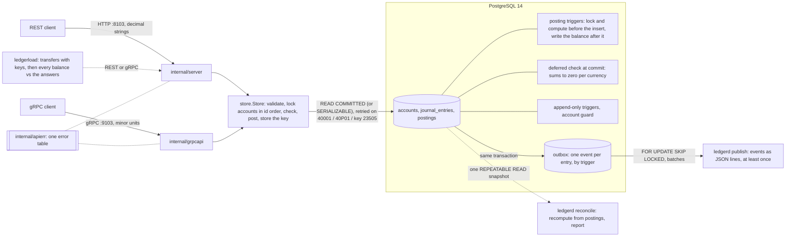

# Ledger

[](https://github.com/vivekdavara/ledger/actions/workflows/ci.yml)

A double-entry payments ledger in Go and PostgreSQL. Every movement of money is a journal entry whose postings sum
to zero in each currency, so money is moved, never created or destroyed. The rule is checked twice: by the Go
validator, for clear errors, and by the database at commit, so no bug, second writer or hand-typed `psql` session
can break it.

> **v1.0.0** (2026-10-15). [CHANGELOG.md](CHANGELOG.md) says what's in it, day by day; [DESIGN.md](DESIGN.md) is
> the full design; [WALKTHROUGH.md](WALKTHROUGH.md) has the questions an interviewer is likely to ask, with answers
> that point at the code.

## Why

A payments ledger has to answer two questions exactly, at any moment: how much each account holds, and why. This
one is built so the answers can't drift, whatever its clients do:

- **Money is conserved.** Every entry's postings sum to zero in each currency, checked by the database at commit as
  well as by the service.
- **Every balance is explained.** The database derives each balance from its postings, numbers each account's
  history without gaps, and refuses to change history.
- **A retry moves money once.** Every request to post carries an idempotency key, stored in the entry's own
  transaction.
  Crash tests kill the server around its commits, and every transfer still posts exactly once.
- **Nothing is lost downstream.** An outbox written in the entry's transaction feeds a publisher that delivers every
  event at least once.
- **It can be checked.** `ledgerd reconcile` recomputes the books from the postings in one snapshot.

"Results" says what each of these costs, measured.

## Architecture



Amounts are `int64` minor units (cents, yen, fils); positive is a debit, negative a credit. An account's stored
balance is the sum of its postings, and the database maintains it, so it can't drift.

## Results at a glance

v1.0.0's own numbers, from the release check (`scripts/release_check.sh` at `e5e4ee4`, the tag's code): Apple M3,
PostgreSQL 14.20 at default settings, client, server and database on one machine, on power, nothing else running.
Medians of 3 runs, or the range of the 3. "Results" has each one's first measurement, its full table and the
comparison.

| What | Result | Command |
|---|---|---|
| Posting one 2-posting entry through the service, one client | 467 µs (8 postings 1,072 µs, 64 postings 5,039 µs) | `make bench` |
| Of which the database's commit-time check | 60 µs (1.8 ms at 64 postings) | `make bench` |
| Answering a retry (a replay) | 86 µs | `make bench` |
| One client over the API | p50 560 µs over REST, 557 µs over gRPC | `make load` |
| Transfers/s, 16 clients at read committed: disjoint wallets, one hot account | REST 5,622 and 2,051; gRPC 5,595 and 2,021; in process 6,755 and 2,173 | `make load`, `make bench-contention` |
| The same at serializable | REST 3,711 and 1,562; gRPC 3,640 and 1,519; in process 4,367 and 1,756; 39–72 of 3,000 hot-account transfers gave up | the same |
| Transfers posted exactly once while `ledgerd` is killed | 600 of 600 in each of the 4 runs, with 9–12 crash-point deaths and 4–6 kills from outside per run | the crash tests |
| One publisher draining the outbox | 103,339–108,696 events/s at batch 1,000 | `make bench-outbox` |
| One reconciliation of 200,000 postings, all ten checks | 724–741 ms | `make bench-outbox` |

## The rules, and what enforces them

| Rule | Go | Database |
|---|---|---|
| An entry's postings sum to zero in each currency | `Entry.Validate` | deferred constraint trigger, at commit |
| 2 to 64 postings, exactly as many as declared | `Entry.Validate` | `CHECK` + the commit-time trigger |
| A posting's currency is its account's | `checkAgainstAccounts`, under the accounts' row locks | composite foreign key `(account_id, currency)` |
| A balance is the sum of its postings, with a gapless version chain | (the database does it) | `BEFORE` and `AFTER INSERT` triggers on postings |
| A protected account never goes below zero | `checkAgainstAccounts` (`Account.Overdraws`), under the row locks | `CHECK` evaluated inside the row-locked update |
| History is append-only | no code path changes it | triggers reject `UPDATE`, `DELETE`, `TRUNCATE` |
| A balance changes only through postings | no code path changes it | guard trigger on accounts |

## Run it

You need Go 1.27 and PostgreSQL 14 on port 5432.

```bash
./scripts/dev-db.sh
```

That creates `ledger` (for running the service) and `ledger_test` (for the tests). Then:

```bash
make check
```

`make check` is what CI runs: `gofmt`, `go vet`, and every test with the race detector. The database tests use
`LEDGER_TEST_DATABASE_URL`, which the Makefile points at `ledger_test`. Without it they skip, except in CI, where
they fail.

```bash
LEDGER_DATABASE_URL="postgres://localhost:5432/ledger?sslmode=disable" go run ./cmd/ledgerd serve
```

`serve` applies any pending migrations (so does `ledgerd migrate`, which then exits) and listens on
`LEDGER_HTTP_ADDR` (REST and health, default `:8103`) and `LEDGER_GRPC_ADDR` (default `:9103`). On SIGTERM both
stop accepting, give in-flight requests 10 s, then cut what's left.

```bash
curl -s localhost:8103/livez
```

```bash
curl -s localhost:8103/readyz
```

`/livez` checks nothing and answers while the process runs. `/readyz` answers 200 only when the database responds
within 2 s and its schema is at the binary's newest migration, and 503 with the reason otherwise.

`ledgerd version` prints the version the go command stamped from git when the binary was built (`v1.0.0` at the
tag, a pseudo-version naming the commit after it, `+dirty` with uncommitted changes, `(devel)` under `go run`), the
commit, the schema version its migrations reach, the Go release, and whether crash points are compiled in. It needs
no configuration.

`LEDGER_ISOLATION` picks the posting transactions' level: `read-committed` (the default) or `serializable`. DESIGN.md,
"Concurrency (days 2 and 3)", says why both keep every rule and what each costs.

```bash
LEDGER_DATABASE_URL="postgres://localhost:5432/ledger?sslmode=disable" go run ./cmd/ledgerd publish
```

`publish` delivers the outbox's events (one per entry, written in the entry's own transaction) as JSON lines on
stdout, at least once each, until SIGTERM, so a consumer dedupes by `id`. Its output starts with an empty line, which
ends a line a killed predecessor may have left cut off in the same file or pipe (day 4), so a consumer skips empty
lines. The first event from the hand check, on the `ledger` database after migration 0009 backfilled its three
entries' events:

```json
{"id":1,"type":"entry_posted","entry_id":1,"description":"Alice tops up $50","posted_at":"2026-10-12T11:24:20.435749-04:00","postings":[{"posting_id":1,"account_id":1,"currency":"USD","amount":5000,"balance_after":5000,"account_version":1},{"posting_id":2,"account_id":2,"currency":"USD","amount":-5000,"balance_after":-5000,"account_version":1}]}
```

```bash
LEDGER_DATABASE_URL="postgres://localhost:5432/ledger?sslmode=disable" go run ./cmd/ledgerd reconcile
```

`reconcile` recomputes the books from the postings in one snapshot and prints a JSON report of ten checks. It
exits 0 when they all agree, 3 when any found a difference (the log names which), 1 when it couldn't run. It
changes nothing, so it doesn't migrate: run it against a current schema.

### Load

With `ledgerd serve` running:

```bash
go run ./cmd/ledgerload -api grpc -layout hot -workers 16 -transfers 3000
```

`ledgerload` creates and funds its own accounts (under a random prefix), posts the transfers from 16 concurrent
clients, and prints throughput, latency percentiles, how each transfer ended, and whether every account it used holds
what the answers imply. `-layout` is `disjoint`, `random` or `hot`; `-wallets`, `-skew` (a Zipf exponent above 1),
`-pad`, `-retry` (send conflicts and unanswered requests again with their key until answered) and `-json` adjust it.
It exits 0 when the books agree, 3 when they don't. Before sending anything it asks the ledger whether it is ready
(`/readyz` over REST, the health service over gRPC), and exits 1 at once if nothing answers or the answer is no.

```bash
make load
```

`make load` runs `scripts/load.sh`: each isolation level, API and layout, three runs each, on a fresh schema padded as
`make bench-contention` pads it, with `ledgerd reconcile` required to exit 0 after every run. It needs `jq` and a quiet
machine; the results are under "Results".

### Crash tests

The crash tests are part of `make check`. They build `ledgerd` with `-tags faults`, which compiles in three crash
points (just before a posting's commit, just after it, and between an outbox delivery and its mark), armed by
`LEDGER_FAULTS`:

```bash
go build -tags faults -o bin/ledgerd-faults ./cmd/ledgerd
```

`LEDGER_FAULTS=store.after-commit:3 bin/ledgerd-faults serve` kills itself with `SIGKILL` just after its third
commit; `store.after-commit:5%` does it with probability 5% at each one. A normal build refuses to start with a spec
in `LEDGER_FAULTS` (a value of only blanks arms nothing and is ignored). DESIGN.md, "Load and failure injection
(day 4)", explains the points and the tests.

## The API

Start the server as above, then (the `id`s are what a fresh `ledger` database gives):

```bash
curl -s -X POST localhost:8103/v1/accounts -H 'Content-Type: application/json' -d '{"name":"cash:bank","type":"asset","currency":"USD"}'
```

```bash
curl -s -X POST localhost:8103/v1/accounts -H 'Content-Type: application/json' -d '{"name":"wallet:alice","type":"liability","currency":"USD"}'
```

Bodies are JSON, sent as `application/json`. Post an entry; the `Idempotency-Key` header is required, and a retry
sends the same one:

```bash
curl -s -X POST localhost:8103/v1/entries -H 'Content-Type: application/json' -H 'Idempotency-Key: top-up-1' -d '{"description":"Alice tops up $50","postings":[{"account_id":1,"currency":"USD","amount":"50.00"},{"account_id":2,"currency":"USD","amount":"-50.00"}]}'
```

The answer is 201 with the entry as posted, each posting with the balance after it and its place in the account's
history. The same request again answers 200 with `Idempotent-Replayed: true` and the same entry, and moves no money.
The same key with a different entry is refused with `idempotency_key_reused`.

```bash
curl -s localhost:8103/v1/accounts/2
```

```bash
curl -s 'localhost:8103/v1/accounts/2/postings?limit=100'
```

```bash
curl -s localhost:8103/v1/entries/1
```

An entry reads back exactly as posting it answered (without the `Idempotent-Replayed` header); each line of an
account's history names its `entry_id`.

Amounts are decimal strings in the currency's major unit (`"20.00"`, `"1500"` for JPY), never floats. A wallet is a
liability, so its stored `balance` is negative (a credit) and its `shown_balance` positive. Errors name a stable
reason and, when one posting is at fault, its index. From the hand check (an account holding $30.00):

```json
{"error":{"reason":"insufficient_funds","message":"posting 0: insufficient funds: account 2 (wallet:alice) has 30.00 USD, the posting takes 30.01","posting":0}}
```

The gRPC service is `ledger.v1.LedgerService` ([proto/ledger/v1/ledger.proto](proto/ledger/v1/ledger.proto)),
with amounts in minor units. Server reflection is on, and grpcurl is pinned in the tools module:

```bash
go tool -modfile=tools/go.mod grpcurl -plaintext -d '{"id": 2}' localhost:9103 ledger.v1.LedgerService/GetAccount
```

The gRPC port also answers the standard health check, as `/readyz` does: `SERVING` when `/readyz` would answer 200,
`NOT_SERVING` when it would answer 503 (the reason goes to the log), so a gRPC client or a Kubernetes gRPC probe needs
no HTTP:

```bash
go tool -modfile=tools/go.mod grpcurl -plaintext localhost:9103 grpc.health.v1.Health/Check
```

A failed call carries the same reason in a `google.rpc.ErrorInfo` (`INSUFFICIENT_FUNDS`, metadata `posting: 0`).
The full error table, and why each status, is in DESIGN.md, "Errors". Keys are shared by the two APIs: in the hand
check, an entry posted over REST came back as `"replayed": true` when the same key and postings, in another order,
were sent over gRPC.

`make proto` lints the proto file and regenerates `internal/gen`; the generated code is committed.

## Design decisions

Each is argued in DESIGN.md, and the numbers are under "Results".

1. **The database enforces the rules; the service explains them.** Go validates every entry first, for errors that
   name the posting at fault. The database checks the same rules again with constraints and triggers, so a bug in
   the service, a second writer or a hand-typed `psql` session can't unbalance the books. The commit-time check
   costs 54 µs of a 302 µs posting (day 1).
2. **The database keeps the balances.** Posting triggers lock the account's row, compute the new balance and the
   next version, and write them. A read is one row, the overdraft rule runs under the lock, and the versions order
   each account's history. A balance summed on read, or kept by the service, could drift from its postings.
3. **Integers for money.** `int64` minor units with exact parsing; REST carries decimal strings, so no client handles
   a float and a balance past 2^53 stays exact in JavaScript.
4. **Idempotency keys commit with their entry, and are looked up before the transaction.** A key and its entry
   commit together or not at all, so a retry can't post twice. The lookup runs outside the transaction because,
   inside a `SERIALIZABLE` one, its predicate lock made unrelated transfers retry (day-2 review).
5. **`READ COMMITTED` with row locks, not `SERIALIZABLE`.** Both keep every rule, because an attempt decides only on
   rows it has locked or written. Under contention `READ COMMITTED` was 1.2 to 1.7 times faster and never gave up;
   `SERIALIZABLE` aborted even transfers that shared nothing (day 3).
6. **An outbox written by a trigger.** An entry's event commits with it, whoever writes the entry, so there is no
   dual write to get wrong. The publisher delivers at least once, and consumers dedupe by `id`.
7. **Reconciliation reports and never repairs.** A difference means a bug or a hand edit; the report says where, and
   a person decides what the books should say.
8. **Crash points that compile away.** Failure injection lives behind a build tag; a release binary has none and
   refuses a crash-point spec in `LEDGER_FAULTS`.

## Limitations

The main ones; DESIGN.md, "Limitations", has every one, with its reason.

- **A hot account is one queue.** Every posting to it takes its row lock, so one account topped out near 2,100
  transfers a second here. Splitting it into sub-accounts is the known fix, not built.
- **One database.** No sharding, so no entries across shards.
- **No authentication or tenants.** Anyone who reaches the ports can post, and keys are one namespace for all
  clients.
- **Keys and published events are kept forever.** There is no retention job yet.
- **No database roles.** The service should connect as a role that owns nothing: the tables' owner can switch the
  triggers off.
- **Delivery is at least once,** and in each account's order only with one publisher and for entries posted
  through the service.
- **Reconciliation reads everything:** 724–741 ms per 200,000 postings. A large ledger would reconcile from a
  checkpoint.
- **The crash tests kill `ledgerd`, not Postgres or the machine,** and the load numbers are one laptop's, with the
  client and the server sharing its cores.

## Tests

206 test functions (193 at the end of day 4, 159 at the end of day 3, 122 at the end of day 2; several table-driven or
property-based, and the concurrency tests run at both isolation levels), all green locally and in CI. `make check`
runs them two packages at a time: each test has a schema and a connection pool of its own, and with every package at
once the suite reached Postgres's 100 connections (day 5).

- `internal/money`: exact parsing and formatting (`"12.345"` in USD is an error, not a rounding), a round-trip
  property over every `int64`, overflow-checked addition against `math/big`, and a fuzz target.
- `internal/ledger`: every validation rule, plus properties over random balanced entries: they validate, moving
  any amount or currency unbalances them, a reversal cancels out, and whether an entry is valid never depends on
  its postings' order, with up to three defects mixed in.
- `internal/store`: each test gets a fresh schema in `ledger_test`. The migration runner (eight concurrent
  runners apply each migration once, at every isolation level); every constraint and trigger by name; ten
  concurrent $5 payments against $30 (always six succeed); every write path (single and multi-row `INSERT`,
  `COPY`, a writable CTE, `ON CONFLICT`, savepoints, `SET CONSTRAINTS`); and a differential property test where the
  Go validator and the database must agree, for the same reason, on random entries carrying none or one of nine
  defects.
- `internal/store`, the service (day 2): idempotent account creation (eight concurrent creates make one account);
  history pages; every rejection names its posting and leaves nothing behind, its key included; a retried request
  posts once, even with its postings reordered; twelve requests with one key, held at a barrier until all have read
  the key as unused, post one entry and replay eleven times; a real serialization failure (another transaction
  holds the account's row and commits once the attempt waits for it) is retried and posts against the new balance;
  retries that run out give `ErrConflict` and store no key; a retry's wait ends with its context; eight workers
  making 80 colliding transfers keep the books balanced. A property test sends random requests at once, each
  several times and some with a different entry under the same key: each key posts exactly once, every send of that
  entry gets it back field for field, and the others are refused (100 cases; it fails against a build that skips the
  hash comparison, and one that doesn't store the key).
- `internal/store`, from the day-2 review: unrelated entries don't make each other retry; two entries racing for one
  key (`23505`, retried, then refused); a deadlock with another session (`40P01`, retried); accounts locked in id
  order whatever the request's order (`NOWAIT` probes while an attempt waits); the key checked before the entry;
  default and largest history pages; the retry delay's bounds for eight policies; and a differential property test
  where the service's account checks and the database's constraints must agree on a posting, for every type,
  overdraft setting and balance out to the edges of `bigint` (1,000 cases); paging that stays stable while postings
  arrive; concurrent creates with clashing types. Each was checked against a build without its mechanism.
- `internal/apierr`: every error's reason, HTTP status and gRPC code, which ones are redacted, and a lost database
  (SQLSTATE 08 and 57P, a broken connection) as unavailable.
- `internal/server`: the REST API over a real schema, including 14 malformed or refused requests, each checked for
  its status, reason, posting and message, and the health endpoints. A request stuck behind a row lock gives up at
  its deadline with 504, uses up no key, and posts once the lock is gone. Twelve bodies `encoding/json` would accept
  (not UTF-8, a key twice, a key in another case, no content type, over 64 KB, and more) are refused; the router's
  404 and 405 are JSON; unplanned errors and a database that is down are redacted; `/readyz` hides connection
  details.
- `internal/grpcapi`: the gRPC API over an in-memory connection (bufconn) on a real schema: the same walkthrough,
  each error's code, `ErrorInfo` reason and posting, and the call deadline. `TestBothAPIsGiveTheSameReason` sends
  28 failing requests through both APIs and requires the same reason and posting from each.
- `internal/store`, day 3: the concurrency tests and both service property tests run at each isolation level. An
  attempt that waits for an account another transaction is changing decides on the balance as committed, at both
  levels (0 retries at `READ COMMITTED`, 1 at `SERIALIZABLE`). A property test sends batches of up to 24 random
  entries at once, in USD and EUR and some converting between them, over protected and unprotected accounts: each
  is accepted or refused for funds and nothing else, each balance is its old one plus the accepted postings, the
  returned postings number each account's versions with no gap or repeat, and no protected account is overdrawn at
  any version. `TestWhatASerializablePostingHasRead` lists one posting's SIRead locks at three ledger sizes. Every
  entry gets one outbox event, whatever writes it, and the migration backfills older entries. Reconciliation: a
  healthy ledger is clean, at the edges of `bigint` too; eleven kinds of damage (made by switching a guard trigger off or dropping a constraint) are
  each reported by exactly the checks they should trip; reports taken while entries are posted are all clean and
  self-consistent, and that test fails if the report doesn't read one snapshot. From the review: a retry that waits
  for the original, or begins just after it commits, replays it even when its own check would refuse it, at both
  levels, and twelve concurrent copies of a payment only one can afford all get the one entry; every test that
  checks its books also reconciles them; an entry committed during migration 0009 gets its event.
- `internal/outbox`: each event published once, in order, with the postings `PostEntry` returned; a failed delivery
  recorded and retried; a delivery whose mark is lost delivered again and deduped; a second publisher skipping the
  first's rows without waiting; one publisher keeping each account's versions in order under six concurrent posters,
  at both levels, with the stream rebuilding every balance; `Run`'s backoff and its cap; a stop during a delivery
  that lets the batch finish; a connection lost during a delivery; an error that isn't storable as it is; a write
  cut off mid-line; JSON lines; a delivery whose context ends stops between events (day 5). Each mechanism was
  removed once to see its test fail, except the forced `READ COMMITTED` of a publisher's transaction, which no test
  can stage (DESIGN.md, "Outbox (day 3)").
- `cmd/ledgerd`: the real binary's `run`: migrations, an account created over REST and read back over gRPC from
  real ports, a clean shutdown of both, a taken port failing startup and releasing the other port, in-flight work
  finishing within the shutdown grace and cut off after it, and 50 stops at startup all exiting 0. Day 3: an unknown
  `LEDGER_ISOLATION` refused, the level the store posts at shown in the log; `publish` writing the events of entries
  posted before and while it runs; `reconcile`'s three exit codes, and that it leaves an old schema as it is.
- Day 4, `internal/faults`: the spec's parser (hit numbers, percentages, misspelled points and impossible rules
  refused); in a normal build a spec is refused and a point does nothing; in the faults build, the test binary runs
  itself as a child and dies by `SIGKILL` on the right hit, after writing the point's line.
- Day 4, `internal/load` and `cmd/ledgerload`: every layout posts each transfer once over both APIs and the books
  agree; the check catches a transfer posted twice and one answered as posted but lost; lost answers settle as
  replays and lost requests as fresh posts, with and without retries; every kind of outcome over both APIs; a skew
  concentrates transfers; twelve concurrent copies of a payment only one can afford, over both APIs at once, all get
  the one entry, ten rounds at each level (3 of 3 runs fail without the re-lookup after a rejection); the command's
  output, JSON, exit codes, and a rerun with the same seed replaying every transfer.
- Day 4, `cmd/ledgerd` crash tests, against a real `ledgerd` built with `-tags faults`: a crash just before or just
  after the commit, over each API, is settled by the retry (a fresh post or a replay, never "insufficient funds");
  600 transfers while `ledgerd` dies at crash points and at random post exactly once, over each API (they fail with
  double posts when the key isn't stored); a publisher killed after its deliveries and at random delivers all 2,000
  events at least once, each account's in order. Each ends with `ledgerd reconcile` exiting 0.
- Day 4, from building and from the review (each fails without its fix): a stop while `serve` or `publish` starts
  exits 0; a request out of attempts gets the entry its key posted; the books check catches faults that cancel out
  (versions); every resend is counted; reruns with another config start afresh; a steep skew ends; bad flags exit 2
  before any request; `Classify` against every reason in apierr's table, over both APIs; retries don't change which
  transfers are sent; settled transfers aren't timed; conflicts are given up or sent again; exit 3 on a mismatch;
  `LEDGER_FAULTS` refused by a release `ledgerd`; crash percentages; each publisher starts on a new line; children
  don't inherit `LEDGER_` settings.
- Day 5, the release: `ledgerd version` needs no configuration, and a real build names its commit (checked against
  `git rev-parse HEAD`); the gRPC health check is `SERVING` on a current schema, `NOT_SERVING` before migration (the
  reason in the log) and within its 2 s when the check hangs, and `NOT_FOUND` for an unknown service; `ledgerload`
  stops before sending anything to a ledger that isn't ready, over either API; an entry reads back exactly as posting
  it answered, byte for byte over REST and field for field over gRPC, with `not_found` and `invalid_argument` the
  same over both. From the review (each fails without its fix): 40 idle stops with a zero grace all exit 0, while a
  gRPC call alone still running at the end of a grace is cut off with exit 1; REST pages past version 2^31; a
  missing key is `invalid_argument` over both APIs; `serve`'s settings are refused before the database is touched;
  `JSONLines` stops between events when its context ends; every REST answer says `Cache-Control: no-store`.

## Results

### Day 1: what the database's rules cost

From `BenchmarkPostEntry` (`internal/store/bench_test.go`). One client posts one
balanced entry per transaction: begin, insert the entry, insert its postings in one statement, commit. So each
number is the latency of one entry, mostly the commit's write to disk. "Check off" disables the commit-time check's
two constraint triggers; the balance triggers stay on.

Apple M3, Postgres 14.20 (Homebrew, default settings), over local TCP. Median of 6 runs per cell, from two rounds
of `-count 3`, run before/after/after/before so that drift hits both builds alike:

| Postings per entry | Check | Before the review fixes (0001–0003) | Now (0001–0007) |
|---|---|---|---|
| 2 | on | 275 µs | 302 µs |
| 2 | off | 232 µs | 248 µs |
| 8 | on | 700 µs | 859 µs |
| 8 | off | 580 µs | 712 µs |
| 64 | on | 3,753 µs | 4,426 µs |
| 64 | off | 2,241 µs | 2,681 µs |

```bash
make bench
```

That runs the current build. For the "before" column, check out `c09ef08` (in a worktree, say) and run `make bench`
there.

What the numbers say:

- **The commit-time check costs about a fifth of a small entry**: 54 µs of 302 µs at 2 postings. At 64 postings
  it is 1.7 ms, 65%, because each posting checks the whole entry again: N + 1 checks of N rows each. The attempt
  to check once per entry (0004) was unsound and was undone (see "Review of day 1").
- **The review fixes cost 10% at 2 postings and 18–23% at 8 and 64.** Each posting now runs two balance triggers
  instead of one (lock and compute before the insert, write after it), and every trigger function runs with a
  pinned `search_path`. The two causes weren't measured separately.
- These are single-client latencies, not throughput. Day 4 measures throughput and contention.
- An earlier run, made while the review agents were using the same Postgres, was up to three times slower on the
  large cases in one round; it isn't reported.

### Day 2: what the service adds

`BenchmarkServicePostEntry` posts the same entries through `Store.PostEntry`, the API's path: validate and hash in
Go, look the key up, then one `SERIALIZABLE` transaction that locks the accounts, inserts the entry, its postings
and the key, and commits. "Replay" sends one key again and again: the cost of answering a retry. One client, Apple
M3, Postgres 14.20 at default settings, at `5fb9557` (migrations 0001–0008). Median of 6 runs, two rounds of
`-count 3` (`make bench`), with nothing else running:

| Postings per entry | Plain insert (check on) | Through the service | Replay |
|---|---|---|---|
| 2 | 300 µs | 434 µs | 80 µs |
| 8 | 849 µs | 1,124 µs | 85 µs |
| 64 | 4,256 µs | 5,001 µs | 116 µs |

- **The service adds 134 µs at 2 postings (45%), 274 µs at 8 and 745 µs at 64.** It sends three more statements
  (the key lookup, the locking `SELECT`, the key insert) and runs at `SERIALIZABLE`, whose predicate locks cost
  more as the entry grows. Their shares weren't measured separately.
- **A replay costs about a fifth of a post** at 2 postings and a fortieth at 64: three reads and no commit to disk.
- The plain-insert column is day 1's "Now" column re-measured with migration 0008: 300, 849 and 4,256 µs against
  302, 859 and 4,426. 0008's CHECK on balances costs nothing these runs can see.

Transfers that share nothing, before and after moving the key lookup out of the transaction (DESIGN.md, "Why the
key lookup is outside the transaction"). 16 workers, each moving $0.10 back and forth between its own two wallets 25
times, all at once, with the default retry policy; three runs each:

| Build | Retries | Requests that ran out of attempts |
|---|---|---|
| Before (`bc5e6f6`) | 285, 215, 324 | 2, 1, 1 |
| After (`2155237`) | 68, 78, 142 | 0, 0, 0 |

```bash
LEDGER_TEST_DATABASE_URL="postgres://localhost:5432/ledger_test?sslmode=disable" go test -count=1 -v -run TestDisjointTransfersRetries ./internal/store
```

For the "before" row, run that test (copied in) at `bc5e6f6`. The retries that remain are day 3's subject.

### Day 3: the isolation levels under contention

`make bench-contention` runs `BenchmarkContention` (`internal/store/contention_bench_test.go`): 16 workers, one
connection each, post 3,000 two-posting transfers at each level, three times. **Disjoint**: each worker moves money
between two wallets of its own. **Random**: between two of 100 wallets. **Hot**: 100 wallets pay one merchant
account. The second half of the target pads the ledger with 20,000 accounts and 10,000 entries first, so Postgres
plans its reads as for tables of that size. Medians of the three runs at `38041c6`, outbox trigger included,
Apple M3, Postgres 14.20 at default settings, on power, nothing else running. (The review's fix that came after
adds a key lookup to rejected requests only, and none of these transfers is rejected.)

| Ledger | Layout | Read committed: transfers/s, retries/transfer, gave up, p99 | Serializable: transfers/s, retries/transfer, gave up, p99 |
|---|---|---|---|
| padded | disjoint | 6,231, 0, 0, 24 ms | 4,042, 0.55, 0, 35 ms |
| padded | random | 6,370, 0, 0, 12 ms | 3,787, 0.73, 0–1, 35 ms |
| padded | hot | 2,113, 0, 0, 52 ms | 1,755, 0.80, 66–78, 195 ms |
| small | disjoint | 4,365, 0, 0, 38 ms | 1,790, 0.59, 99–113, 208 ms |
| small | random | 1,629, 0, 0, 87 ms | 1,512, 0.56, 137–144, 210 ms |
| small | hot | 541, 0, 0, 110 ms | 801, 1.14, 191–294, 234 ms |

```bash
make bench-contention
```

- **Read committed is faster on every padded layout, 1.2 to 1.7 times, and never retries.** Serializable retries
  0.55 to 0.80 times a transfer, and 2 to 3% of the hot account's transfers run out of attempts and return
  `conflict` to their client. That decided the default: `READ COMMITTED` since day 3 (`ec83ff1`).
- **Serializable gives up on transfers that share nothing.** On small tables, 3.3 to 3.8% of the disjoint transfers
  gave up. `TestWhatASerializablePostingHasRead` shows why: one posting has read the whole of `journal_entries` and
  `postings` (and of `accounts`), and every concurrent posting writes there, so Postgres sees a read-write cycle.
  On the padded ledger the reads shrink to index pages, but new entries all land on the same last page, and the
  retries remain. DESIGN.md, "Why serializable aborts transfers that share nothing", has the lock lists.
- On the small hot account serializable's raw rate is higher, but 6 to 10% of its transfers fail; counting only
  those that posted, 597 to 956 a second against 445 to 556.
- "Gave up" counts as finished in transfers/s. The p99s include serializable's backoff, up to 100 ms a retry.

The day-2 test of disjoint transfers now runs at both levels: `TestDisjointTransfersRetries` (the command above)
logged 0 retries at read committed and 198 retries, 2 gave up, at serializable in today's first run alongside the
other tests.

### Day 3: what the outbox and the new default cost one client

`make bench` again, at three builds: before the outbox (`f581a56`, serializable), with it (`4eed7ca`, still
serializable), and now (`ff899c7`, read committed). Two rounds of `-count 3` each, the second in the opposite order,
so medians of 6; Apple M3, Postgres 14.20 at default settings, on power, nothing else running:

| Postings per entry | Plain insert, check on: before → with the outbox | Through the service: before → with the outbox → read committed | Replay |
|---|---|---|---|
| 2 | 304 → 321 µs | 461 → 465 → 462 µs | 81–82 µs |
| 8 | 792 → 818 µs | 1,133 → 1,113 → 1,243 µs | 85–86 µs |
| 64 | 4,575 → 4,439 µs | 5,041 → 5,056 → 4,979 µs | 118–119 µs |

```bash
make bench
```

For the first two columns, run it in a worktree at `f581a56` and at `4eed7ca`.

- **The outbox's trigger costs about 17 µs an entry**: 304 → 321 µs at 2 postings with the check on, 250 → 268 µs
  with it off; the six runs of each build don't overlap. At 8 and 64 postings it is lost in the spread between runs
  (8 postings: 698–880 µs before, 737–916 with it).
- **Through the service the three builds are within their run-to-run spread at every size,** the 8-posting row
  included (944–1,238, 1,018–1,272 and 1,086–1,250 µs). One client never waits for anyone, so the isolation level
  doesn't show here; it shows under contention, above.
- Day 2's service numbers (434 / 1,124 / 5,001 µs) came from other runs on another evening; compare within a table,
  not across them.

### Day 3: the outbox and reconciliation

`make bench-outbox`, at `38041c6`, three runs each, same machine:

| What | Result |
|---|---|
| One publisher draining 10,000 events into a JSON encoder, batch 100 (`BenchmarkPublish`) | 63,963–71,266 events/s |
| The same, batch 1,000 | 107,173–107,830 events/s |
| One reconciliation of 100,000 entries, 200,000 postings, 200,000 accounts (`BenchmarkReconcile`) | 546–571 ms (before the day-3 review's fixes; 724–741 ms at v1.0.0, under "Release check") |

```bash
make bench-outbox
```

The publisher's numbers are an upper bound for one process: the sink discards what it encodes. A real broker's
acknowledgement would add its round trip per batch.

### Day 4: the API under contention

`make load` (`scripts/load.sh 3 3000`) at `82301aa`: `ledgerload` against a real `ledgerd` over loopback, 16 workers
and a pool of 16 connections, 3,000 two-posting transfers a run, three runs each, every run on a fresh schema padded to
20,000 accounts and 10,000 entries. The in-process column is `BenchmarkContention` with `-padding 20000` (the second
half of `make bench-contention`), run right after on the same commit. Medians of three; Apple M3, Postgres 14.20 at
default settings, on battery (45% at the start of the session, 18% at the end; Low Power Mode off).

| Read committed | In process | REST | gRPC |
|---|---|---|---|
| disjoint | 6,904/s, p99 16 ms | 5,372/s, p99 19 ms | 5,617/s, p99 22 ms |
| random | 6,673/s, p99 12 ms | 5,394/s, p99 15 ms | 5,418/s, p99 13 ms |
| hot | 2,140/s, p99 58 ms | 2,062/s, p99 18 ms | 1,949/s, p99 23 ms |

| Serializable: transfers/s, retries/transfer, gave up | In process | REST | gRPC |
|---|---|---|---|
| disjoint | 4,165, 0.56, 0 | 3,783, 0.60, 0–1 | 3,212, 0.63, 0–1 |
| random | 4,094, 0.79, 0–1 | 3,553, 0.74, 1 | 2,388, 0.76, 1–2 |
| hot | 1,756, 0.81, 69–75 | 1,523, 1.15, 45–61 | 1,364, 1.09, 59–61 |

```bash
make load
```

- **At read committed the API keeps 78 to 81% of the in-process rate** on disjoint and random wallets, and 91 to 96%
  on the hot account, where one row lock, not the API, sets the pace. The client, the server and Postgres share the
  same 8 cores, so some of the difference is the client's own CPU.
- **At serializable REST keeps 87 to 91%; gRPC 58 to 78%,** with a wide spread between its runs (random: 2,261, 2,388
  and 3,343 a second). Not investigated further.
- **The books agreed after every one of the 42 runs** (36 here and 6 with one client), and `ledgerd reconcile` exited
  0 after each; the script stops at the first run where it doesn't.
- The hot account's p99 over the API (18 to 23 ms) is below the in-process one (58 ms). Not investigated; compare the
  rates, which agree.
- **One client, no contention** (the last six runs of `make load`: disjoint, 2,000 transfers, read committed): p50
  554 µs over REST and 544 µs over gRPC, p99 958 and 1,463 µs. Day 3 measured 461 to 465 µs for the same posting in
  process (`make bench`, on another day and an unpadded ledger), so the API and the loopback round trip add about a
  tenth of a millisecond.

Today's in-process numbers are 0 to 11% above day 3's padded ones (6,231 / 6,370 / 2,113 and 4,042 / 3,787 / 1,755),
which were measured on power.

### Day 4: crashes

The crash tests are part of `make check`; their logs show what each run did:

```bash
go test -race -count=1 -v -run 'TestKillsDuringLoad|TestAKilledPublisher|TestACrash' ./cmd/ledgerd
```

Two runs at `32fa5af`, each over REST and gRPC at both levels, 8 clients and 600 transfers per run, `ledgerd` dying
at every 40th commit of a process (just before or just after it) and every third process killed from outside:

| Run | Processes | Point crashes | Kills from outside | Answered as replays | Sent again |
|---|---|---|---|---|---|
| REST, read committed | 15, 14 | 10, 9 | 4, 4 | 20, 12 | 337, 316 |
| REST, serializable | 16, 14 | 10, 9 | 5, 4 | 10, 17 | 382, 319 |
| gRPC, read committed | 18, 16 | 12, 10 | 5, 5 | 14, 13 | 371, 385 |
| gRPC, serializable | 17, 19 | 11, 12 | 5, 6 | 10, 14 | 346, 458 |

Every transfer posted exactly once in every run: 600 transfer keys, 620 entries, every balance and version as the
answers imply, `ledgerd reconcile` clean. The killed publisher, in the same two runs: 15 and 19 processes, 11 and 14
crashed just after a delivery, 3 and 4 killed from outside; 3,400 and 3,600 lines for the 2,000 events, every one
delivered at least once, each account's in version order after dedupe, no line cut off.

Throughput under crashes is not a result: it is set by how often the test kills `ledgerd` (270 to 495 transfers a
second here, with each restart taking its share).

### Release check

```bash
scripts/release_check.sh
```

Run at `e5e4ee4`, the code v1.0.0 is tagged with (only docs changed after it), 10:43 to 10:54 on 2026-10-15: Apple M3,
PostgreSQL 14.20 at default settings, on power, nothing else running. Every step passed:

- `make check` (27 s), then `make check` on a clean `git archive` of the commit (32 s), so the release needs nothing
  that isn't committed.
- `make bench`, one round of `-count 3` (medians of 3; the day sections have medians of 6):

  | Postings | Plain insert, check on | Check off | Through the service | Replay |
  |---|---|---|---|---|
  | 2 | 328 µs | 268 µs | 467 µs | 86 µs |
  | 8 | 817 µs | 661 µs | 1,072 µs | 89 µs |
  | 64 | 4,773 µs | 2,935 µs | 5,039 µs | 123 µs |

  Day 3's last build (`ff899c7`): 321, 818 and 4,439 µs check on; 268 µs check off at 2 postings; 462, 1,243 and
  4,979 µs through the service; replays 81–82, 85–86 and 118–119 µs. Every median is within 8% of those, except the
  service at 8 postings, 14% below (runs of 974–1,143 µs, against day 3's 1,086–1,250).
- `make bench-contention`, padded ledger, transfers/s at read committed and serializable: disjoint 6,755 and 4,367,
  random 6,836 and 4,321, hot 2,173 and 1,756; read committed never retried, serializable retried 0.47, 0.71 and 0.83
  times a transfer and gave up on 0, 0–1 and 71–72 of 3,000. Small tables, serializable: 117–126 of 3,000 disjoint
  transfers gave up. Day 3 (on power): 6,231 / 6,370 / 2,113 and 4,042 / 3,787 / 1,755; day 4 (on battery): 6,904 /
  6,673 / 2,140 and 4,165 / 4,094 / 1,756.
- `make load`, transfers/s over REST and gRPC (in process above):

  | | Read committed: REST | gRPC | Serializable: REST | gRPC (gave up) |
  |---|---|---|---|---|
  | disjoint | 5,622 | 5,595 | 3,711 | 3,640 (0) |
  | random | 5,684 | 5,457 | 3,780 | 3,478 (0–1) |
  | hot | 2,051 | 2,021 | 1,562 (44–51) | 1,519 (39–54) |

  One client: p50 560 µs over REST and 557 µs over gRPC. The books agreed after all 42 runs, and `ledgerd reconcile`
  was clean after each. Day 4's gap between gRPC and REST at serializable (gRPC 2,388 a second on random wallets,
  with a run at 2,261 and one at 3,343) didn't appear in this run, which was on power where day 4's was on battery:
  gRPC's three random runs were 3,569, 3,478 and 3,266. Not investigated further.
- `make bench-outbox`: one publisher 58,326–70,971 events/s at batch 100 and 103,339–108,696 at batch 1,000 (day 3:
  63,963–71,266 and 107,173–107,830). **One reconciliation of 200,000 postings: 724–741 ms, against day 3's 546–571.**
  Day 3 measured it at `38041c6`, before its own review added two checks (`posting_currencies`, `orphan_rows`) and
  made the sums `numeric` so they can't overflow (`7f00bb4`); the 546–571 ms was the old reconciliation's, and the
  README cited it as current until this check.
- The crash tests, once: over REST at read committed 14 starts, 9 crashes at a point and 4 kills from outside; REST
  serializable 15, 10 and 4; gRPC read committed 18, 12 and 5; gRPC serializable 19, 12 and 6. Every one of the 600
  transfers posted exactly once in each. The publisher: 19 processes, 14 killed after a delivery and 4 from outside;
  3,614 lines for the 2,000 events, none cut off.

## What the reviews found

After each day's core was built, review agents read it, each in its own git worktree, reviewing a fixed commit, with
correctness questions (do the rules hold on every write path, in every failure?). They reported only what they had
reproduced; I reproduced each finding again before fixing it, and each fix has a test that fails without it. Their
lists of tests that still passed with the mechanism removed drove most of the new tests each day.

### Review of day 5 (the release)

One agent read the whole repo at `1b585b5` (16 minutes), for rules that held when written but not after later days,
and for docs that no longer match the code.

1. **A stop with a zero grace always failed.** With `LEDGER_SHUTDOWN_GRACE=0s`, 40 of 40 stops of an idle server
   exited 1, logging gRPC calls cut off that didn't exist: the expired deadline won a `select` against
   `GracefulStop`, which takes a moment even with nothing to wait for. The gRPC server now counts its running calls,
   and a stop fails only if any were cut off. The old cut-off test couldn't have caught a gRPC-side bug, since its
   REST request alone made it exit 1, so a test with a gRPC call alone was added.
2. **REST couldn't page past version 2^31.** `after_version` was parsed as an `int32`, so REST would have refused its
   own `next_after_version` once an account passed 2,147,483,647 postings (about 12 days for a hot account at the
   rate measured here), while gRPC answered.
3. **The APIs gave different reasons for a missing idempotency key:** `malformed_request` over REST, `invalid_argument`
   over gRPC (which can't tell a missing field from an empty one). Both say `invalid_argument` now, and the cross-API
   test has the case.
4. **A typo in `serve`'s settings migrated the database first:** `LEDGER_ISOLATION=bogus` applied the migrations,
   then exited 1. The settings are checked before the database is touched.
5. **Six docs errors**, all fixed. DESIGN.md said concurrent copies of a request that share an account fail with
   `40001`, which is true at `SERIALIZABLE` only: at `READ COMMITTED` they wait for the row, then fail on the key or
   are refused and replay. "Posting an entry, step by step" missed the two key lookups days 3 and 4 added. The
   README's `publish` example didn't say the output starts with an empty line, its rules table still said "(day 2)",
   its outbox tests claimed every mechanism was tested, and DESIGN.md's error table put a missing key under
   `malformed_request`.

Tests that still passed with their mechanism removed: `JSONLines`'s check of its context between events, and every
answer's `Cache-Control: no-store`; each now has a test that fails without it. Two more have no test: the publisher's
forced `READ COMMITTED`, whose race is inside one statement (DESIGN.md, "Outbox (day 3)"), and the reconciliation's
`READ ONLY`, which guards against a write no code path makes. A test the review saw fail once
(`TestALostConnectionDuringDeliveryLosesNoEvent`, "published 0") passed 300 runs in a row here; it had the window
day 4 closed in its sibling test, and now polls the same way.

Found while releasing:

- `make check` failed once with "too many clients" (SQLSTATE 53300). Every test has a schema and a pool of its own,
  and with every package at once the suite reached Postgres's 100 connections; it now runs two packages at a time
  (sampled peak 82 → 56–57).
- The release check found the README's reconciliation time stale: 546–571 ms was measured before day 3's review
  added two checks and `numeric` sums, and v1.0.0's is 724–741 ms ("Release check").

### Review of day 4

Once the load generator and the crash tests were in (`1c8e796`), two review agents read them, one the crash points
and crash tests, one the load generator, each in its own git worktree (13 minutes each). They reported only what they
had reproduced, and I reproduced each finding again before fixing it; each fix has a test that fails without it.

1. **The books check couldn't see faults that cancel out.** In the disjoint layout a worker's transfers go back and
   forth between its two wallets, so with every transfer posted twice (240 entries for 120 transfers), every one lost,
   or just a worker's first two doubled, every balance still matched the answers. The check compares versions (the
   number of postings) too now.
2. **A request out of attempts could be told `conflict` though its key had posted** (a hypothesis in the review,
   reproduced with two copies held at a barrier and one attempt each): the last attempt lost a race for the key
   (`23505`) or the account (`40001`) to a copy that committed. `conflict` tells a client nothing posted. Running out
   of attempts now looks the key up once more, as a rejection does.
3. **`net/http` resent some POSTs by itself, uncounted.** It treats a request with an `Idempotency-Key` header as safe
   to send again on a reused connection that broke (go1.27.1, `Request.isReplayable`): 80 requests reached the server
   for 40 lost answers, while the generator counted 10 resends. Safe against this ledger, but invisible; the client
   now turns it off.
4. **Rerunning a prefix with another config gave false mismatches** and `idempotency_key_reused`: names and keys now
   carry a tag of the config. **A steep skew hung the random layout** (skew 30: still running after the run's
   deadline). **Bad flags exited 1 after a request** instead of 2 before one.
5. **The crash tests' stop raced a restart** (1 publisher run in 25): a child started just before the stop got the
   `SIGTERM` during startup. I had found the cause while building (a stop while `serve` or `publish` connects or
   migrates exited 1; it exits 0 now, `80923b6`) before the report came; the supervisor also accepts death by
   `SIGTERM`, which is what a stop before Go's handlers are in place gets.
6. **A publisher killed mid-line could cost the next one its first event,** in output that outlives a process (a
   file, a kept-open pipe): the next line was glued onto the fragment. `ledgerd publish` starts its output on a new
   line now.
7. Smaller: a spec of blanks in `LEDGER_FAULTS` said crash points were armed; a crash point as PID 1 in a container
   would have blocked forever (the kernel drops init's own `SIGKILL`), and now exits; gRPC calls had no deadline;
   the children inherited the test's own `LEDGER_` settings.

Tests that still passed with their mechanism removed, now fixed: the random killer (nothing asserted a kill: with it
removed both tests passed; every third process is now killed from outside and the tests require it), crash
percentages (5% firing on every hit), the release build's refusal through `ledgerd`, four of `Classify`'s outcomes and
gRPC's code fallback, retries changing later transfers, settled transfers being timed, retrying after a conflict, and
the exit code 3. Judgement calls are in DESIGN.md's "Limitations".

### Review of day 3

Once the day's work was in (`ec83ff1`), two review agents read it: one the isolation levels and the
reconciliation, one the outbox and the new subcommands, each in its own git worktree and test schemas. They
reported only what they had reproduced, and I reproduced each finding again before fixing it; each fix has a test
that fails without it.

1. **A retry of a request that had posted could be refused.** A retry finds its key unused, then waits for the
   accounts while the original commits; at `READ COMMITTED` the wait hands over the balance the original left, and
   a $40 payment from Alice's $50 was refused for insufficient funds: the client was told the payment failed, though
   it posted. A rejection is now checked against the key once more: the same entry replays, a different one is
   `idempotency_key_reused`. Twelve concurrent copies of that payment failed at both levels without the fix
   (`TestARetryThatWaitedForTheOriginalReplaysIt`, `TestConcurrentCopiesOfAPaymentOnlyOneCanAffordAllGetIt`).
   Day 2's version of the test paid $20, which every copy's own check allowed, so it couldn't see this.
2. **A failed delivery could go unrecorded.** The error was cut at byte 500, so a multi-byte character across the
   cut, or a NUL anywhere, made Postgres refuse the record, and that error was dropped
   (`TestAnyDeliveryErrorIsRecorded`).
3. **A write cut off mid-line lost an event to line-reading consumers,** though it was marked published: the retry's
   first line was glued onto the fragment. `JSONLines` now ends a cut-off line before its next delivery
   (`TestALineCutOffByAFailedWriteLosesNoEvent`).
4. **Reconcile failed instead of reporting** a `balance_after` at the end of `bigint` (its chain sum overflowed),
   and **reported nothing** for postings relabelled to another currency or for an entry deleted with its rows left
   behind. It sums as `numeric` now and has two more checks, `posting_currencies` and `orphan_rows`.

Tests that still passed with their mechanism removed, now fixed: the transfer property accepted the database's
fallback refusals, so it passed without the service's row lock (refusals must now name their posting); no test
moved a version, so the version comparisons could go; the outbox write paths beyond the service were checked only
by hand (`checkBooks` now reconciles after the 22 tests that call it); the backfill's `ORDER BY` and its read
committed snapshot; the backoff's cap. Running the suite for the fixes also turned up a flaky test: a stop between
a delivery and its mark left an event to be sent again, and `Run` now lets the batch in flight finish. Judgement
calls are in DESIGN.md's "Limitations".

### Review of day 2

After the API was built, two review agents read it, one for the store's posting logic and one for the REST and gRPC
layers, each in its own git worktree and test schemas. They reported only what they had reproduced; I reproduced
each finding again before fixing it, and each fix has a test that fails without it. Three of the API agent's
findings were already fixed by then (account id 0 disagreeing between the APIs, no request deadline, a stale
README line); I had found the first while writing the cross-API test.

1. **Unrelated transfers made each other retry.** The idempotency-key lookup ran inside the `SERIALIZABLE`
   transaction, where a read that finds nothing takes a predicate lock on where the key would be (the index page,
   or the whole small table); every concurrent request writing a key there then counted as a conflict. 16 workers on their own wallets: 215–324 retries and 1–2 requests out
   of attempts, three runs. The lookup now runs before the transaction: 68–142 retries, none out of attempts
   (`TestDisjointTransfersRetries`, `TestUnrelatedEntriesDontMakeEachOtherRetry`).
2. **The retry delay panicked** for a `MaxDelay` near `MaxInt64` (`rand.N(MaxInt64 + 1)`), overflowed its shift for
   a large `BaseDelay`, and misread zero values (`TestRetryDelayStaysWithinItsBounds`).
3. **REST requests weren't cut off at the end of the shutdown grace,** and the pool's `Close` waited for them; a
   stop as the server started could exit 1 (`TestShutdownCutsOffWorkStillRunningAfterTheGrace`,
   `TestAStopAsServeStartsIsClean`).
4. **Postgres's text reached clients**, in the conflict message and in the database fallback's detail, and a
   backend killed mid-request was a 500 instead of a 503. Redaction itself had no test that could fail
   (`TestUnplannedAndUnavailableErrorsAreRedacted`, `TestTranslateNamesTheConstraintNotPostgresText`).
5. **REST accepted what the ledger refuses:** invalid UTF-8 (two names became one account), repeated keys (the last
   won), field names in any case; also no content-type check, 400 for an oversized body, text/plain 404s and 405s,
   and messages naming Go types (`TestRESTRefusesWhatEncodingJSONWouldAccept`, `TestRouterErrorsAreJSON`).
6. **The APIs disagreed on negative paging values** (`TestBothAPIsGiveTheSameReason` has them now).

They also listed tests that still passed with their mechanism removed: the key check, the `23505` and `40P01`
retries, id-order locking, history page sizes, the -2^63 rule, the body cap, the default page's cursor, gRPC's
message cap, and a listener left open on a failed start. Each now has a test that fails without it, checked by
removing the mechanism. Judgement calls that stayed as they are, with the reason, are in DESIGN.md's
"Limitations".

### Review of day 1

After the core was built, two review agents read it, one for the SQL and one for the Go, and reproduced what they
suspected. I re-ran every finding myself before fixing it. Five were real; each fix has a test that fails without
it:

1. **A balance could move with no posting** (both agents). The balance moved in a `BEFORE INSERT` trigger, and
   `INSERT ... ON CONFLICT DO NOTHING` on a conflicting posting then skipped the row but kept the balance change:
   `INSERT 0 0`, no error, and the books stopped summing to zero. Fixed in migration 0006 (the balance is written
   by an `AFTER` trigger); `TestASkippedPostingMovesNoBalance`.
2. **An optimisation let an unbalanced entry commit.** Migration 0004 skipped a posting's commit-time check when
   its entry was the transaction's own. `SET CONSTRAINTS ALL IMMEDIATE` used up the entry's check early, and a
   posting appended afterwards was never checked. Undone in 0005; `TestAnEarlyCheckDoesNotExcuseLaterPostings`.
3. **A temporary table could stand in for `accounts`.** The trigger functions resolved table names through the
   caller's `search_path`, where `pg_temp` comes first. Pinned in 0007;
   `TestATempTableCannotStandInForTheLedgersTables`, `TestEveryFunctionPinsItsSearchPath`.
4. **The migration lock failed under a serializable default.** Its snapshot predated the lock wait, and 7 of 8
   concurrent runners re-applied migrations. Migrations now run at `READ COMMITTED`; the race test runs at all
   three isolation levels.
5. **Tests that hang instead of failing.** A missing rollback or timeout would have hung the run, and CI's
   implicit 10-minute test timeout equalled the job's. Tests now check for leaked connections, the readiness test
   has its own deadline, and `go test` runs with `-timeout 4m`. (A property test that couldn't fail on what its
   name claimed was also rewritten.)

## Layout

```
cmd/ledgerd/              the binary: migrate, serve REST + gRPC, publish the outbox, reconcile; the crash tests
cmd/ledgerload/           the load generator's command
proto/ledger/v1/          the gRPC API's definition
internal/money/           currencies, amounts, exact parsing
internal/ledger/          Entry, Posting, Validate; Account, its type and shown balance; the Service interface
internal/store/           Open, the migration runner, Ready; Store, the service (ledger.go); Reconcile
internal/store/migrations 0001 to 0009 (DESIGN.md, "Schema", says what each does)
internal/store/storetest/ a fresh schema per test
internal/outbox/          the outbox's publisher, its sinks, Dedupe and CheckOrder
internal/apierr/          the one table from errors to reasons, HTTP statuses and gRPC codes
internal/faults/          crash points: nothing in a normal build, SIGKILL in a -tags faults build
internal/load/            the load generator: REST and gRPC clients, outcomes, Run and its books check
internal/server/          HTTP: health endpoints and the REST API (api.go)
internal/grpcapi/         gRPC: LedgerService, the health service, the running-call count
internal/gen/             generated from proto/ by make proto (committed)
tools/                    the code generators and grpcurl, in their own module
scripts/                  dev-db.sh (the local databases), load.sh (make load), release_check.sh (the release check)
```

## License

MIT
